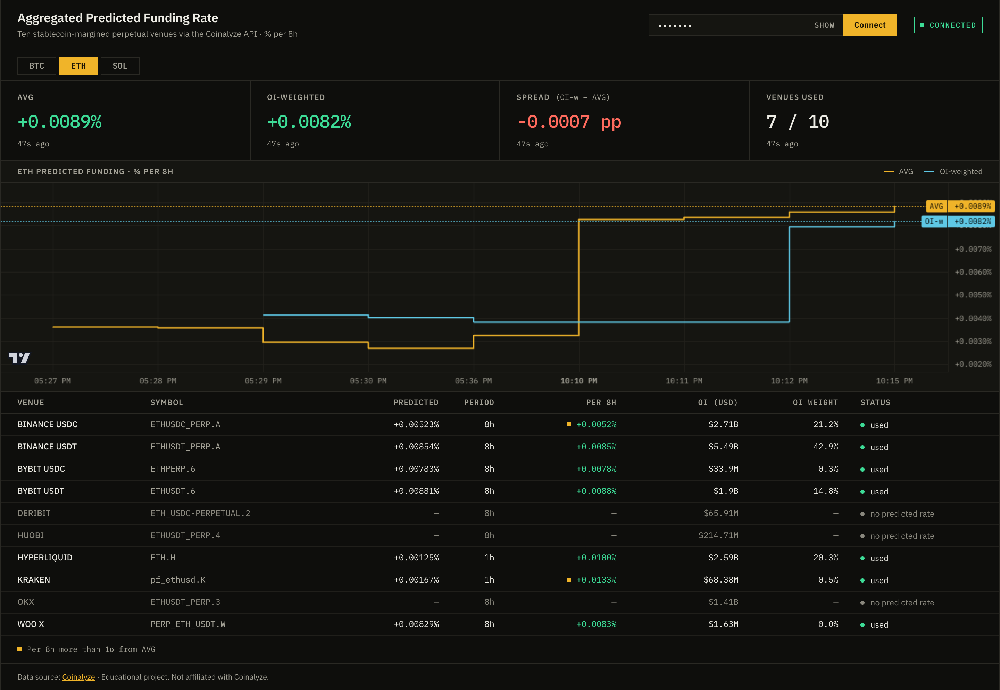
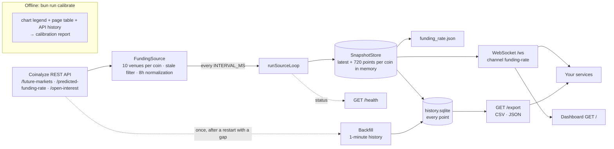

# Predicted Funding Aggregator

[](https://github.com/tarikcaykara/predicted-funding-aggregator/actions/workflows/ci.yml)
[](https://bun.sh)
[](https://www.typescriptlang.org)
[](https://www.docker.com)
[](LICENSE)

A self-hosted Bun + TypeScript service that computes the cross-venue **aggregated predicted funding rate** for BTC, ETH and SOL from the official Coinalyze API, normalized to % per 8h, and streams it over an authenticated WebSocket. Every published number can be traced to its venues: a live dashboard shows the simple and open-interest-weighted averages next to the per-venue breakdown they come from. Every point is archived in SQLite and can be exported as CSV or JSON.



## Why

- **The API has no aggregate.** Coinalyze exposes predicted funding rates per market (`/predicted-funding-rate`). Its "Aggregated Predicted Funding Rate" exists only as a chart on coinalyze.net, and the funding page itself notes that the chart *"is not updated in real-time yet"*.
- **The predicted rate is the forward-looking one.** It is the rate the next settlement is heading towards, which makes it a useful input for bots, alerts and carry dashboards.
- **Free, self-hosted and transparent.** Commercial data APIs sell aggregated funding series (for example, CoinGlass offers OI-weighted funding-rate history). This project uses a free API key, runs on your own machine, and documents and measures exactly which venues and normalizations go into each number.

**Which number to use:**
- **AVG:** a simple mean over venues, the same method Coinalyze uses by default.
- **OI-weighted:** weights each venue by its USD open interest, so it reflects where positions actually sit.

## How it works



- **One loop.** Intervals are measured start-to-start and the first poll runs immediately. A failed cycle is logged, counted in `/health` and retried on the next cycle; the loop never exits the process.
- **API budget.** Each symbol in a request costs one call, the limit is 40 calls per sliding 60 s window, and a request takes at most 20 symbols. Predicted rates are fetched first every cycle. Open interest is refreshed on a rolling basis: a market is refetched once its value is 10 min old, oldest first, a few markets per cycle using the spare budget. Defaults (3 coins × 10 venues at 60 s) still come to about 33 calls/min, with no 10-minute burst. A client-side sliding window mirrors the server's, so the client waits instead of being rejected. Two consecutive cycles never fit in one window, so each cycle's first request waits for the previous cycle's first request to leave it, and polls settle at about `INTERVAL_MS` + 250 ms. A 429 (for example from another process using the same key) is retried after `Retry-After` and logged as a warning.
- **Backfill budget.** After a restart with a gap, the one-off backfill costs one call per market reporting a rate plus one per listed market: 51 for the defaults. In a real-API run, the second poll came 3 minutes after the first instead of 1, and polls were back to 60 s after that. The rebuilt range runs into that pause, so the chart has no hole there: the largest step between points was 144 s.
- **Caching.** The market list is cached for 24 h; open interest uses a per-market rolling refresh.
- **Persistence.** The latest snapshot per coin is written to `funding_rate.json`, so a restart serves data immediately. On restart, open interest is also seeded from that file if it is at most 30 min old, so OI-weighted is available from the first poll. Every point is written to the SQLite file `history.sqlite` in one transaction per cycle and kept, unless `HISTORY_RETENTION_DAYS` is set. The dashboard chart and the WebSocket `history` message use the last 720 points per coin (about 12 h at 60 s), so the chart survives a restart. After a restart with a gap, the last 24 h of the gap are rebuilt from Coinalyze's 1-minute history ([Backfill](#methodology)); anything older stays a gap. `funding_rate.json` is replaced atomically (temp file + rename). If a write fails, live clients still get the snapshot, and the cycle counts as failed in `/health`.
- **Archive.** The archive is the only copy of the aggregate. Coinalyze has no aggregate endpoint and keeps only the last 1500–2000 points of each intraday series ([API docs](https://api.coinalyze.net/v1/doc/)), so lost points cannot be fetched again. Three coins at 60 s add about 1 MB a day. [`GET /export`](#get-export) reads it.

## Methodology

**Venues.** These are the ten stablecoin-margined venues that coinalyze.net lists in the "Current / Predicted" table of each coin's funding page (BTC, ETH and SOL list the same ten). They are defined in [`src/funding/universe.ts`](src/funding/universe.ts). Each venue resolves to the one perpetual on that exchange with that quote currency.

| Venue | Coinalyze code | Quote | API rate period |
|---|---|---|---|
| Binance USDC | A | USDC | 8h |
| Binance USDT | A | USDT | 8h |
| Bybit USDC | 6 | USDC | 8h |
| Bybit USDT | 6 | USDT | 8h |
| Deribit | 2 | USDC | 8h (no predicted rate in the API) |
| Huobi | 4 | USDT | 8h (no predicted rate in the API) |
| Hyperliquid | H | USD | **1h → ×8** |
| Kraken | K | USD | **1h → ×8** |
| OKX | 3 | USDT | 8h (no predicted rate in the API) |
| WOO X | W | USDT | 8h |

Everything else the API lists is deliberately left out, so it cannot skew the average: prediction-market contracts (Polymarket), other quote currencies (ETHBTC, ETHU, USD1), coin-margined contracts and venues the site doesn't aggregate.

**Per venue, every cycle.** Each venue ends up in one of these states:
- `used`: it has a fresh predicted rate.
- `stale`: the rate's `update` timestamp is older than 15 minutes. One API feed was found returning a 12-day-old value.
- `no_rate`: the API reports no predicted rate for it.
- `unlisted`: the coin has no matching perpetual on that venue.

The dashboard and every snapshot show this state for each venue.

**Aggregation over the `used` venues.** For each `used` venue $i$, $r_i$ is its predicted rate normalized to % per 8h and $OI_i$ its open interest in USD:

$$\text{AVG} = \frac{1}{n}\sum_{i=1}^{n} r_i \qquad\qquad \text{OI-weighted} = \frac{\sum_i r_i \cdot OI_i}{\sum_i OI_i}$$

The OI-weighted average only counts venues that also have a positive open interest. It is `null` until open interest has been fetched for every used venue (about 3–4 minutes after a cold start without a recent `funding_rate.json`), and is never computed over a partially fetched set.

**Open interest.** `open_interest_usd` is the total open interest in USD of every listed venue: `used`, `stale` and `no_rate` alike, because a stale or missing predicted rate says nothing about a venue's size. A market whose OI the API omits counts as 0. The total is `null` until every listed market's OI has been fetched once, and, like each venue's `oi_usd`, it is refreshed on the rolling 10-minute schedule. It is not the OI-weighted denominator, which sums only the `used` venues.

**Backfill.** When the first successful poll after a start comes more than 3 intervals after a coin's newest archived point, the service rebuilds the gap from Coinalyze's 1-minute history (`/predicted-funding-rate-history`, `/open-interest-history`). This happens once per process; gaps from an outage while the service runs are not filled.
- **Range:** points at whole minutes, `INTERVAL_MS` apart (rounded to minutes), from the gap start until the rate history arrived. At most the last 24 h are rebuilt, because Coinalyze keeps only 1500–2000 one-minute bars.
- **Rules:** each point uses today's venue list and the live rules. A venue's rate is the close of its newest bar, used if that bar closed at most 15 minutes earlier (the staleness limit), and normalized to 8h. Its open interest is the close of its newest OI bar within 60 minutes, because sparse markets publish OI bars rarely (WOO X: up to 16 minutes apart). OI-weighted and the total OI follow the same completeness rules as a live poll.
- **Marking:** rebuilt points carry `"source": "backfill"` in the archive, the WebSocket `history` message and `/export`.
- **Accuracy:** rebuilt values are close to live ones but not identical. Against 21 live polls over 6 minutes (2026-11-03), the median relative difference was 0.16% for AVG, 0.10% for OI-weighted and 0.08% for the total OI. The largest AVG difference was 28%, on a single point.

## Calibration

The coinalyze.net chart is the reference for both the venue list and the 8h factors. `bun run calibrate` is an offline tool, not part of the service. It drives a headless Chromium (Playwright with `puppeteer-extra-plugin-stealth`) and, once a minute, reads three things:
1. the chart legend "Aggregated Predicted Funding Rate · AVG close 10" on the 1-minute interval;
2. the page's per-venue "Current / Predicted" table;
3. the API's predicted rates for the same venues.

It then reports:
- **Listing drift:** whether the page still shows exactly the venues in `VENUES`, or `unknown` when no sample could read the venue table.
- **Rate periods:** the median page ÷ API ratio per venue (≈1 for 8h venues, ≈8 for hourly ones).
- **Tracking:** the mean absolute difference (MAD) between the chart and several candidate series. These are compared live, and against the API's own 1-minute predicted-rate history over the previous 3 hours, to measure how far the chart lags and whether it is smoothed.

```bash
bunx playwright install chromium   # once
COINALYZE_API_KEY=… bun run calibrate --samples 60 --gap-s 60   # ≈ 1 hour; Ctrl-C stops early and still reports
```

### Results (2026-10-14 21:11–21:53 UTC, 40 samples)

For BTC, ETH and SOL, the page showed exactly the ten venues in `VENUES`.

| Venue | Expected page ÷ API | BTC | ETH | SOL | Check |
|---|---|---|---|---|---|
| BINANCE USDC | 1 | 0.998 | 0.994 | 1.030 | ok |
| BINANCE USDT | 1 | 0.999 | 1.001 | 0.990 | ok |
| BYBIT USDC | 1 | 1.000 | 0.999 | 0.998 | ok |
| BYBIT USDT | 1 | 0.998 | 0.990 | 1.001 | ok |
| DERIBIT | 1 | — | — | — | no data |
| HUOBI | 1 | — | — | — | no data |
| HYPERLIQUID | 8 | 8.000 | 8.170 | 7.643 | ok |
| KRAKEN | 8 | 7.995 | 8.006 | 8.008 | ok |
| OKX | 1 | — | — | — | no data |
| WOO X | 1 | 0.999 | 1.002 | 0.991 | ok |

| Coin | Mean chart (% per 8h) | API AVG vs chart, lag 0 (MAD) | API history: best lag · MAD | 10-min SMA: best lag · MAD |
|---|---|---|---|---|
| BTC | 0.00576% | 0.00291 pp (50.5%) | 81 min · 0.00175 pp (30.3%) | 78 min · 0.00176 pp (30.5%) |
| ETH | 0.00437% | 0.00101 pp (23.0%) | 165 min · 0.00025 pp (5.6%) | 161 min · 0.00032 pp (7.4%) |
| SOL | -0.00039% | 0.00358 pp (912.0%) | 166 min · 0.00022 pp (55.1%) | 161 min · 0.00050 pp (128.4%) |

Every venue with an API rate lands within 5% of its expected ratio, so the 8h factors hold. Deribit, Huobi and OKX have no predicted rate in the API and show as `no_rate`. For ETH and SOL, the chart matches the API AVG from about 165 minutes earlier (residual MAD 0.00025 pp and 0.00022 pp), and a 10-minute SMA tracks worse. The chart is therefore delayed, not smoothed. BTC tracked poorly in this window (best lag 81 min, MAD 0.00175 pp). SOL's percentages are large because its mean rate is near zero.

## Quick start

1. **Get a free API key.** Sign in or sign up at [coinalyze.net](https://coinalyze.net), open [coinalyze.net/account/api-key](https://coinalyze.net/account/api-key/) and click **Generate**. Generating a key deactivates the previous one immediately, and the new key only starts working **2 minutes** after it was generated.
2. **Configure and run:**

```bash
git clone https://github.com/tarikcaykara/predicted-funding-aggregator.git
cd predicted-funding-aggregator
cp .env.example .env    # set AUTH_TOKEN (e.g. openssl rand -hex 32) and COINALYZE_API_KEY
bun install
bun run start           # dashboard on http://localhost:3000, WebSocket on /ws
```

Open the dashboard and enter your `AUTH_TOKEN`. It is masked by default; **Show** reveals it and **Hide** masks it again. The token is kept in the browser's `localStorage`, so the page reconnects on reload. Each coin button shows that coin's OI-weighted rate; arrow keys, Home and End move between coins. Below the chart, every venue is a dot on a shared rate axis with AVG and OI-weighted markers: the dot's area is proportional to the venue's OI weight, rows are sorted by 8h rate, and excluded venues are struck through and hatched. The chart's lower pane shows the spread (OI-weighted − AVG). At each UTC day boundary the time axis shows the local date instead of a time; other labels and the crosshair use local time. The data age and every headline value get a **STALE** marker when the last snapshot is older than three poll intervals. On screens narrower than 1100 px the sidebar moves above the content and each venue becomes a card.

The previous "Ledger" dashboard (v3.1) is archived at tag `v3.1.0`; its design export is in `design/handoff/ledger/`. To switch back: `git rm -r -q web && git checkout v3.1.0 -- web`, then run `bun run typecheck`. It flags anything in `web/app.ts` that a later protocol change broke.

Bun loads `.env` automatically, so no `dotenv` package is needed.

## Docker / Compose

```bash
cp .env.example .env    # set AUTH_TOKEN (e.g. openssl rand -hex 32) and COINALYZE_API_KEY
docker compose up --build -d
docker compose ps       # "healthy" after the first check
```

- **Image:** about 260 MB. Based on the pinned `oven/bun:1.4.4-debian`, runs as the non-root `bun` user, which can write only `/app/data` (the application code is root-owned), with a `HEALTHCHECK` on `/health`. `.dockerignore` is an allowlist: only `package.json`, `bun.lock`, `tsconfig.json`, `LICENSE`, `src/` and `web/` enter the image, so untracked files in the checkout stay out of it.
- **Persistence:** the image sets `DATA_FILE=/app/data/funding_rate.json` and `HISTORY_FILE=/app/data/history.sqlite`; compose sets the same paths (they override the `./` paths in a copied `.env`) and mounts the named volume `data` there, so the latest snapshots and the history archive survive container re-creation.
- **Shutdown:** SIGTERM triggers a graceful shutdown.

## Deployment security

- The dashboard, `/ws` and `/export` are plain HTTP. On `ws://` the token crosses the network in clear text, and so does the `Authorization` header of an export.
- Compose publishes the port on every interface. Beyond localhost or a trusted network, put the service behind a TLS reverse proxy (the dashboard then switches to `wss://` automatically) and restrict the port with a firewall.
- `AUTH_TOKEN` must be at least 32 characters; generate it with `openssl rand -hex 32`.
- Client messages over 16 KiB are rejected. Connection limits and rate limiting belong to the proxy.
- `bun run start` serves the production bundle; `NODE_ENV=development` enables Bun's dev server and is for local development only.

## Configuration

| Variable | Default | Description |
|---|---|---|
| `PORT` | `3000` | HTTP + WebSocket port (1–65535) |
| `AUTH_TOKEN` | *(required)* | Token WebSocket clients must send, at least 32 characters (e.g. `openssl rand -hex 32`); there is no default |
| `COINALYZE_API_KEY` | *(required)* | Coinalyze API key |
| `COINALYZE_BASE_URL` | `https://api.coinalyze.net/v1` | Coinalyze API base URL. For the e2e test's fake server or a proxy; http(s) only |
| `COINS` | `BTC,ETH,SOL` | Comma-separated subset of `BTC`, `ETH`, `SOL` |
| `INTERVAL_MS` | `60000` | Poll interval. 3 coins at 60 s ≈ 33 of the 40 calls/min |
| `DATA_FILE` | `./funding_rate.json` | Where the latest snapshots are persisted |
| `HISTORY_FILE` | `./history.sqlite` | SQLite archive of every history point. The service exits 1 at startup if it cannot be opened |
| `HISTORY_RETENTION_DAYS` | *(unset)* | Delete history points more than this many days older than a coin's newest point (1–36500). Unset or blank keeps every point |
| `PING_INTERVAL_MS` | `30000` | WebSocket ping interval |
| `PONG_TIMEOUT_MS` | `65000` | Close a client that hasn't sent a pong within this window; must be greater than `PING_INTERVAL_MS` |
| `AUTH_TIMEOUT_MS` | `10000` | Close a client that hasn't authenticated within this window |
| `NODE_ENV` | *(unset)* | `development` serves the dashboard through Bun's dev server (HMR, error overlay); any other value serves the production bundle. The Docker image sets `production` |

Integers must be positive whole numbers; timers are at most 2147483647 ms and `PORT` at most 65535. A missing required variable or an invalid value stops the process at startup with a clear message.

## WebSocket protocol

Endpoint: `ws://<host>:<PORT>/ws`. All messages are JSON. The message types are defined in [`src/protocol.ts`](src/protocol.ts) and shared by the server and the dashboard.

| Direction | Message |
|---|---|
| client → server | `{"type":"auth","token":"<AUTH_TOKEN>"}` (must arrive within `AUTH_TIMEOUT_MS`) |
| server → client | `{"type":"auth","status":"ok","coins":["BTC","ETH","SOL"],"interval_ms":60000}` |
| server → client | `{"type":"history","points":[HistoryPoint, …],"latest":[Snapshot, …]}` right after auth |
| server → client | `Snapshot` on every successful cycle, one per coin |
| server → client | `{"type":"ping"}` every `PING_INTERVAL_MS`; reply with `{"type":"pong"}` |
| server → client | `{"type":"error","message":"invalid json" \| "unknown message type"}` |

A `Snapshot`, which is also the element type of the `funding_rate.json` array (`components` truncated):

```json
{
  "type": "snapshot",
  "symbol": "BTC",
  "coin": "bitcoin",
  "timestamp": 1793715538161,
  "aggregated_predicted_funding_rate": 0.009612242857142855,
  "oi_weighted_predicted_funding_rate": 0.009830999157123849,
  "markets": 7,
  "open_interest_usd": 22256316220.77746,
  "unit": "percent_per_8h",
  "components": [
    {
      "venue": "HYPERLIQUID",
      "symbol": "BTC.H",
      "predicted_rate": 0.00125,
      "rate_period_hours": 1,
      "rate_8h": 0.01,
      "oi_usd": 3128090562.549,
      "updated_at": 1793715537989,
      "status": "used"
    }
  ]
}
```

A `HistoryPoint` is a `Snapshot` without `components`. Points rebuilt after a restart also carry `"source": "backfill"` (see [Methodology](#methodology)); live points have no `source`.

| Close code | Meaning |
|---|---|
| `4001` | invalid token (the server sends `{"type":"auth","status":"error","message":"invalid token"}` first) |
| `4002` | pong timeout |
| `4003` | no auth message within `AUTH_TIMEOUT_MS` |
| `1009` | a client message larger than 16 KiB, sent unparsed |

**Migrating from v1:**
- `aggregated_predicted_funding_rate`, `coin` and `timestamp` keep their names.
- The value is now this service's API aggregate rather than the number scraped from the chart.
- Several coins share the `funding-rate` channel, so filter on `symbol`.
- After the `auth` ok reply, the first message is `{"type":"history"}`.
- `funding_rate.json` is an array of the latest snapshot per coin.
- `INTERVAL_MS` keeps its meaning. There is no default `AUTH_TOKEN` anymore.

## `GET /health`

Returns `200` with `"status":"ok"` while the last successful poll is within 3 intervals. Before the first success, it also stays `ok` until 3 intervals have passed since startup. Otherwise it returns `503` with `"status":"down"`.

```json
{ "status": "ok", "uptime_s": 1034, "interval_ms": 60000, "last_success_at": 1792094065961, "consecutive_failures": 0, "last_error": null }
```

## `GET /export`

Streams one coin's archived points from `history.sqlite` as CSV (default) or a JSON array of `HistoryPoint`s. The token goes in a header, never in the URL, so it stays out of access logs and shell history.

```bash
curl -H "Authorization: Bearer $AUTH_TOKEN" "http://localhost:3000/export?symbol=BTC&from=1793664000000" -o btc.csv
```

| Parameter | Default | Meaning |
|---|---|---|
| `symbol` | *(required)* | `BTC`, `ETH` or `SOL`, case-insensitive; coins no longer in `COINS` can still be exported |
| `from` | `0` | Inclusive start, ms since the epoch |
| `to` | *(no limit)* | Exclusive end, ms since the epoch |
| `format` | `csv` | `csv` or `json` |

```csv
timestamp,time,symbol,aggregated_predicted_funding_rate,oi_weighted_predicted_funding_rate,markets,open_interest_usd,source
1793715477914,2026-11-03T14:17:57.914Z,BTC,0.008608514285714287,,7,,live
1793715538161,2026-11-03T14:18:58.161Z,BTC,0.009612242857142855,0.009830999157123849,7,22256316220.77746,live
```

- Rates are % per 8h, at full precision; `open_interest_usd` is in USD (see [Methodology](#methodology)). Empty fields mean the value was not available yet, as in the first poll after this cold start. Points archived before v4.2 have an empty `open_interest_usd`. `source` is `live`, or `backfill` for a point rebuilt after a restart. `time` is the UTC form of `timestamp`.
- A missing or wrong token returns `401` with `WWW-Authenticate: Bearer`. An invalid parameter returns `400` with `{"error": "…"}`.
- The response is streamed 1000 rows at a time, so a long range does not build up in memory, and polling continues while it is read.

## Development

```bash
bun test            # unit, integration and e2e tests; loopback only, no external network, no browser
bun run typecheck   # tsc --noEmit (strict)
```

Dependabot opens weekly update PRs for the Bun packages and the GitHub Actions. The Bun runtime (`Dockerfile`, CI `bun-version`, `@types/bun`) is bumped by hand, all together; see "Dependencies" in [`CLAUDE.md`](CLAUDE.md). CI also runs `bun audit --audit-level=high`, which fails on a high or critical advisory in any package in `bun.lock`, transitive ones included.

```
src/
  main.ts                    entry: config → store → source → loop → server; signals
  config.ts                  env → Config
  coins.ts                   coin registry (symbol → Coinalyze slug)
  types.ts                   Snapshot, MarketComponent, Source
  protocol.ts                WebSocket messages, close codes, history limit (shared with web/)
  log.ts                     stderr logger (stdout is reserved for the calibration report)
  store.ts                   SnapshotStore (latest → funding_rate.json, every point → history.sqlite, range reads)
  export.ts                  /export query parsing, CSV/JSON streaming (pure)
  loop.ts                    runSourceLoop (drift-free, never exits)
  health.ts                  computeHealth (pure)
  server.ts                  Bun.serve: dashboard, /health, /export, /ws
  coinalyze/client.ts        CoinalyzeClient (chunking, 429 Retry-After, 401, 1-minute history)
  coinalyze/rate-limiter.ts  sliding window (40 calls / 60 s)
  funding/universe.ts        the ten venues and their rate periods
  funding/aggregate.ts       AVG / OI-weighted (pure)
  funding/source.ts          FundingSource (venue resolution, rolling OI, staleness, components)
  funding/backfill.ts        Backfill: rebuilds a restart gap from 1-minute history, once per process
web/                         dashboard (Bun HTML import + lightweight-charts, JetBrains Mono + Space Grotesk fonts)
design/handoff/              design exports: number-line/ (current), ledger/ (v3.1, archived); not shipped in the image
scripts/calibrate/           offline calibration (Playwright; dev dependency)
test/                        bun:test suites; e2e.test.ts runs src/main.ts against fake-coinalyze.ts
```

## Design notes: v1 → v2

v1 was a single 390-line `scraper.js` that read the number off the chart with headless Chromium. Writing v2 meant fixing what v1 did on bad days and rethinking what the service should be.

**Fixing v1's failure modes:**
- **Zombie process.** A startup failure left the WebSocket server running with scraping dead, and nothing reported it. Now the first poll runs inside the same retrying loop as every other poll, and `/health` reports staleness.
- **Leaked browsers.** Each browser restart leaked a Chromium process. The calibration tool's `BrowserManager` now owns exactly one instance, and a test asserts that each instance is closed exactly once.
- **Silent timeframe reset.** A reload put the chart back on its default interval. A loose selector (`:has-text("1m")`) could also match "1M" (month) or "15m". The interval is now re-selected after every reload from the dropdown item `data-value="1"`, and the selection is verified.

**Rethinking the design:**
- **The chart became an offline tool.** The chart is not real-time, its markup changed while v2 was being written, and keeping it live cost about 1.1 GB of Chromium in the image along with a whole class of shutdown races. Its real value is as a reference, so it now lives in `bun run calibrate`. The service image shrank from 1.32 GB to about 240 MB.
- **Explicit venues instead of "everything the API returns".** An early v2 averaged every stablecoin-margined perpetual the API listed (21 for ETH). That included a prediction market, exotic quote currencies and a 12-day-old value. Pinning the ten venues the site itself aggregates, plus a staleness filter, fixed that and cut the API budget from about 57 to 30 symbols.

## Disclaimer

Educational project, not affiliated with Coinalyze, and not financial advice. The service uses only the official API. The optional offline calibration tool automates a browser session on coinalyze.net; review Coinalyze's terms before running it. Data source: [Coinalyze](https://coinalyze.net).

## License

[MIT](LICENSE)
